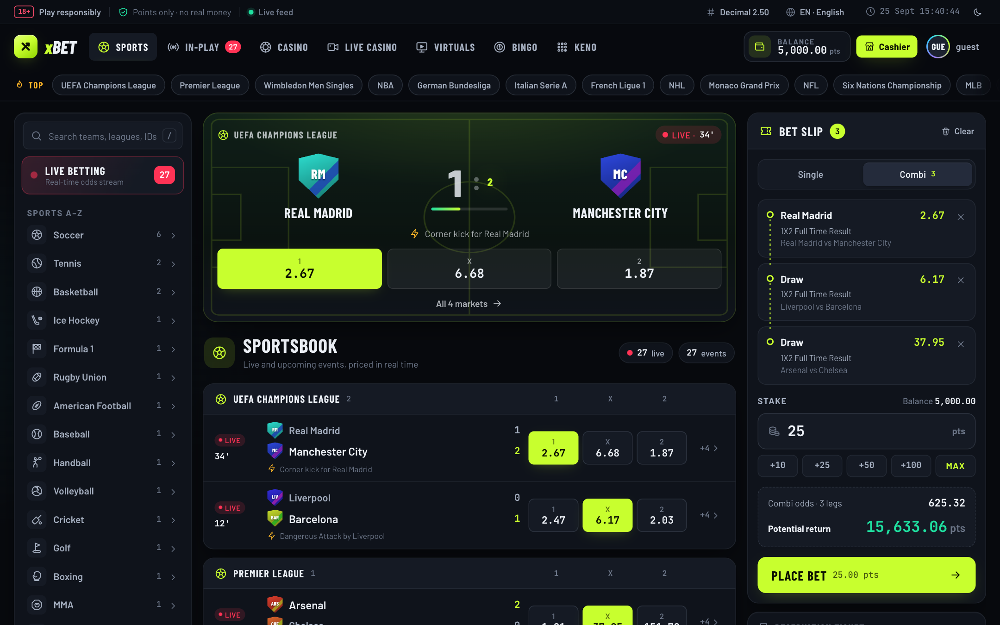
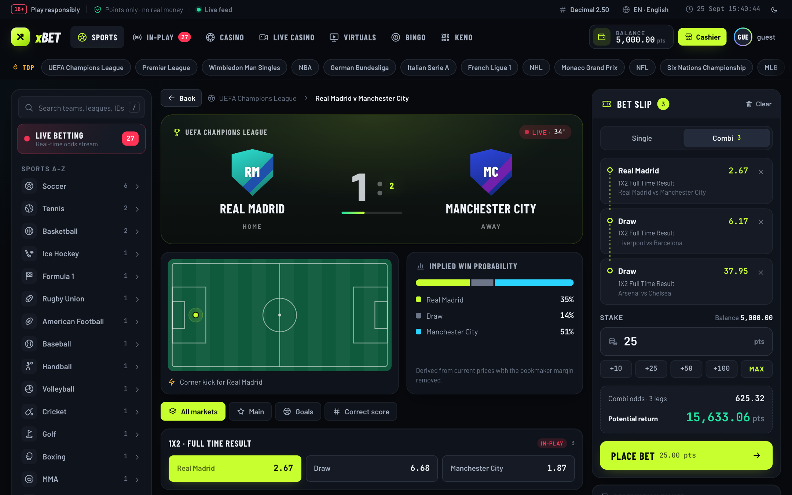
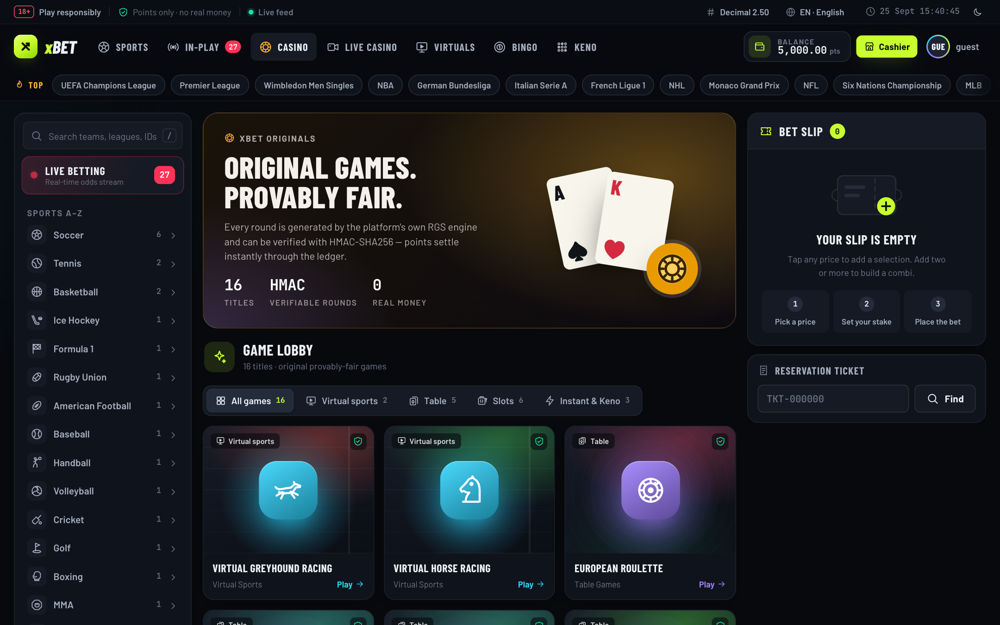
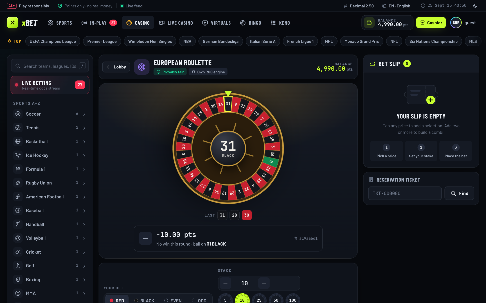
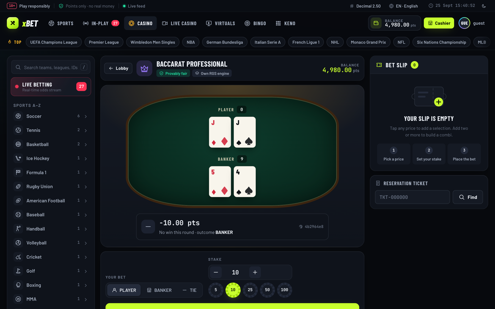
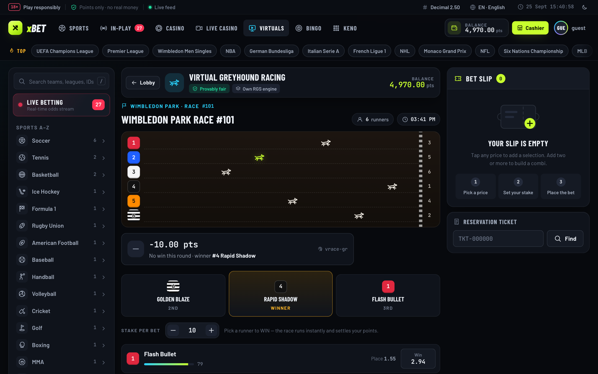
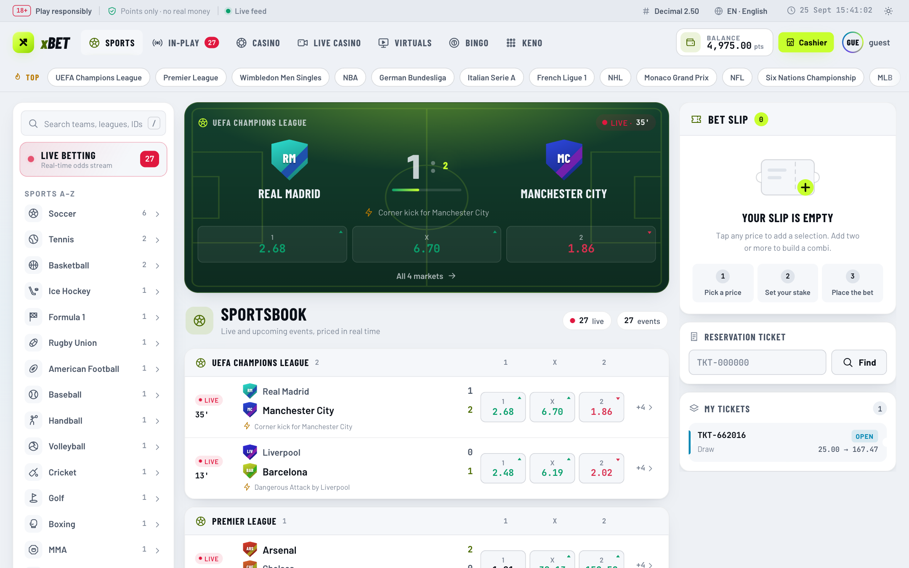
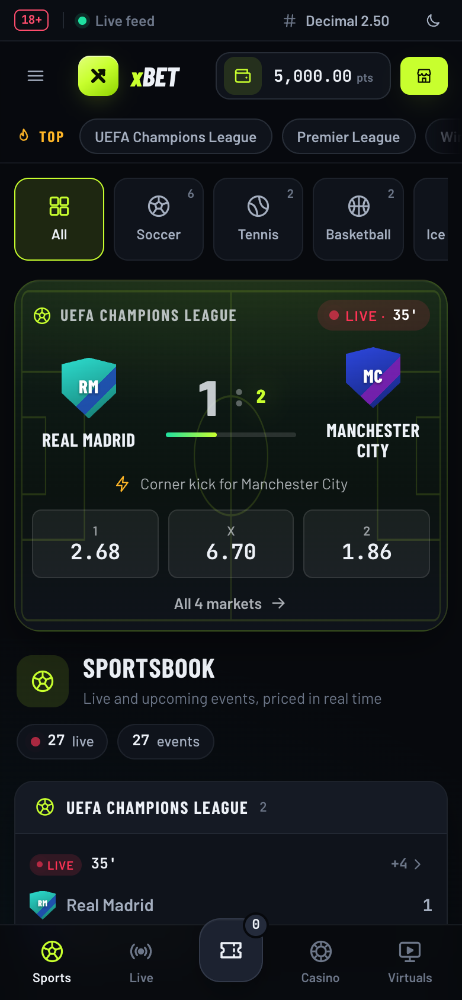
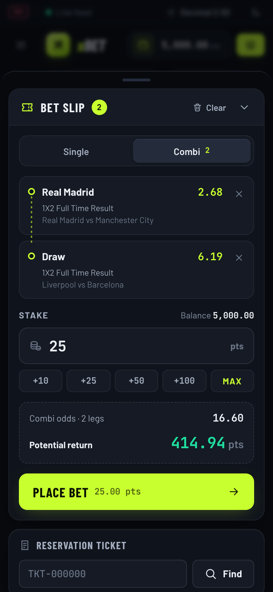
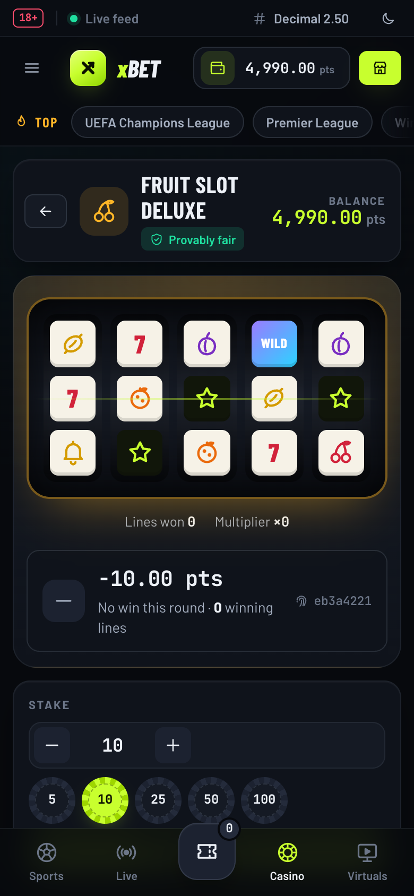

<p align="center"></p>

# xBET — Open-Source Real-Time Sportsbook, Casino & Betting Engine (TypeScript / Node.js Microservices)

> **A real-time sports betting, in-play odds ingestion, casino gaming engine, and double-entry ledger platform built with TypeScript, Node.js, PostgreSQL 16, Redis 7, and Kubernetes.**

> ⚠️ **Educational / research project. Points-based only — no real money is ever involved.**
> This repository is not affiliated with, endorsed by, or associated with bet365 or any other
> gambling operator, data feed, payment provider, or gaming studio named in this codebase as an
> illustrative example. It ships with no real payment integrations, no real odds-feed contracts,
> and no gambling license. Anyone deploying this for real-money wagering is responsible for
> obtaining their own licensing and provider agreements — this project provides none of that.

## Standalone GitHub Pages demo

A browser-only build of the frontend with a full simulated sportsbook and casino — no backend, sign-up or real money:

- ~38 events across 7 sports (soccer, tennis, basketball, ice hockey, American football, baseball, handball) that kick off,
  score and finish on an accelerated clock, with ~200 markets priced from the live match state;
- singles, multiple singles and combis that settle against the simulated result, plus cash out;
- a persistent 5,000-point demo wallet with P/L, balance chart and ledger;
- 12 casino and virtual-racing games with realistic long-run returns.

```sh
npm run test:demo
npm run build:pages
npm run preview:pages
```

Open http://127.0.0.1:4173/xbet/. The upload-ready site is `dist/pages/`. Publishing is manual only and has not been
triggered. See the [GitHub Pages demo guide](docs/github-pages-demo.md) for details and publishing steps.

## Current restricted pilot

With `XBET_PILOT_MODE=true`, the supported product is simulated soccer singles and European roulette backed by PostgreSQL, credentialed accounts, durable settlement and shared player protection. The broader screenshots/catalog below describe demonstration modules; unsupported games, vouchers, payments and cashout are disabled in this mode. Start and verify the pilot using the [points pilot runbook](docs/points-pilot-runbook.md), including migrations 001–005, shared secrets and the required PostgreSQL test gate. Container deployment and an observed pilot remain release gates.

---

## Screenshots

<p align="center">
  
</p>
<p align="center"><sub><b>Sportsbook</b> — featured live match, competition-grouped fixtures with live drift indicators, and a combi bet slip with quick-stake chips.</sub></p>

<table>
  <tr>
    <td width="50%"><br><sub><b>Match centre</b> — scoreboard, pitch tracker, implied win probability derived from live prices, filterable markets.</sub></td>
    <td width="50%"><br><sub><b>Casino lobby</b> — original provably-fair titles with category tabs.</sub></td>
  </tr>
  <tr>
    <td width="50%"><br><sub><b>European roulette</b> — the wheel lands on the pocket returned by the RGS engine; recent-numbers strip and round ID.</sub></td>
    <td width="50%"><br><sub><b>Baccarat</b> — the actual player and banker hands dealt by the engine.</sub></td>
  </tr>
  <tr>
    <td width="50%"><br><sub><b>Virtual greyhound racing</b> — runners animate to the engine's finish order, with trap silks and a podium.</sub></td>
    <td width="50%"><br><sub><b>Light theme</b> — every colour is a design token; the choice is remembered per browser.</sub></td>
  </tr>
</table>

<table>
  <tr>
    <td width="33%"><br><sub><b>Mobile board</b> — sport strip and bottom navigation.</sub></td>
    <td width="33%"><br><sub><b>Bet slip sheet</b> — slides up from the bottom bar.</sub></td>
    <td width="33%"><br><sub><b>Slots</b> — reels render the engine's returned grid.</sub></td>
  </tr>
</table>

---

## Table of Contents

1. [Screenshots](#screenshots)
2. [About](#about)
3. [Core Capabilities & Highlights](#core-capabilities--highlights)
4. [System Architecture](#system-architecture)
5. [Repository & Microservice Layout](#repository--microservice-layout)
6. [Technology Stack](#technology-stack)
7. [Web Frontend & Design System](#web-frontend--design-system)
8. [Real-Time Protocols & Ingestion Pipeline](#real-time-protocols--ingestion-pipeline)
9. [Casino & Provably Fair Gaming](#casino--provably-fair-gaming)
10. [Double-Entry Ledger & Financial Settlement](#double-entry-ledger--financial-settlement)
11. [Getting Started & Local Development](#getting-started--local-development)
12. [Testing & Quality Assurance](#testing--quality-assurance)
13. [Production Deployment & Kubernetes](#production-deployment--kubernetes)
14. [Security](#security)
15. [Contributing](#contributing)
16. [Code of Conduct](#code-of-conduct)
17. [License](#license)

---

## About

**xBET Next-Gen Platform** is a distributed, event-driven iGaming engineering platform engineered entirely in TypeScript and Node.js. It represents the complete modernization of monolithic gaming architectures into high-performance, horizontally scalable microservices designed for massive sports betting volume, ultra-low latency odds dissemination, and mathematically sound financial settlement.

The platform provides a complete end-to-end ecosystem:
- **Real-Time Sportsbook**: In-play odds streaming over WebSockets, rapid fixture synchronization, automated market suspension, and dynamic cash-out calculations.
- **Provably Fair Casino & Mini-Games**: Original crash engine (Aviator), Plinko pegboard physics, Lucky 6 drum draws, 16+ classic video slots, and an example live-dealer studio integration pattern (not affiliated with any provider).
- **Virtual Sports**: Real-time simulated 6-trap greyhound racing (Dogs.Main) and virtual horse tracks with dynamic form cards and video telemetry.
- **Fintech-Grade Ledger**: Strict double-entry accounting enforcing zero-discrepancy mathematical invariants, atomic wallet balances, retail POS cashier till shifts, voucher redemption, and automated affiliate/agent commissions.
- **Omnichannel Delivery**: Responsive Progressive Web App (PWA) client with interactive 2D match pitch radar, dynamic betslip, and ESC/POS thermal receipt printing for land-based retail betting shops.

All legacy monolithic PHP code has been completely phased out. The repository contains 100% pure TypeScript and modern infrastructure configurations.

---

## Core Capabilities & Highlights

- **Real-Time Streaming**: Pushes in-play match updates and odds ticks over persistent WebSocket channels using a compact delimiter-based wire protocol.
- **Immutable Double-Entry Ledger**: Every wager, win, refund, cash-out, deposit, and withdrawal generates atomic double-entry journal entries with zero float drift.
- **Provably Fair RNG Engine**: Deterministic HMAC-SHA256 outcome verification enabling players and auditors to independently verify every round's integrity.
- **Multi-Feed Normalization**: Ingests disparate sports data feeds (TheOddsAPI, EnetPulse, OddService) into a unified normalized fixture and odds domain model.
- **Automated Settlement & DLQ**: Real-time event result ingestion automatically grades single, accumulator/parlay, and system tickets, backed by a persistent dead-letter queue for resilient retries.
- **Retail Cashier & Thermal Printing**: Generates ESC/POS byte streams with Code128 barcodes and QR codes for retail betting slips, ticket booking reservations, and shift financial audits (X/Z reports).
- **Internationalization (i18n) & RTL**: Minimal translation catalogs in 14 compatibility locale directories with English fallback with automatic bidirectional Right-to-Left (Persian, Hebrew, Arabic) layout mirroring.
- **Cloud-Native Scalability**: Ready for zero-downtime deployment with Docker Compose, NGINX API Gateway, and Kubernetes Helm charts with dynamic Horizontal Pod Autoscalers (HPA).

---

## System Architecture

```text
                                 [ Internet / Edge ]
                                          |
                                    (Cloudflare)
                                          |
                              [ NGINX API Gateway :80 ]
                  (Reverse Proxy, Rate Limiting, SSL, WebSocket Upgrade)
                                          |
          +-------------------------------+-------------------------------+
          |                               |                               |
    /api/v1/odds                    /api/v1/betting                 /api/v1/casino
   /ws/odds (RTDT)                 /api/v1/wallet                  /api/v1/virtual
          |                               |                               |
          v                               v                               v
+--------------------+          +--------------------+          +--------------------+
|    Odds Engine     |          |   Betting Engine   |          |   Casino Engine    |
| (services/odds)    |          | (services/betting) |          | (services/casino)  |
|  - Feed Ingestion  |          |  - Bet Validation  |          |  - Provably Fair   |
|  - In-Play Drift   |          |  - Ticket Creation |          |  - Slots & Tables  |
|  - 2D Match Radar  |          |  - Cashout Worker  |          |  - Virtual Dogs    |
|  - WebSocket Gate  |          |  - Settlement DLQ  |          |  - Live Aggregator |
+--------------------+          +--------------------+          +--------------------+
          |                               |                               |
          |       +-----------------------+                               |
          |       |                       |                               |
          v       v                       v                               v
    +-----------+-------------+     +--------------------+          +-------------+
    |   Redis 7 (Pub/Sub)     |     |   PostgreSQL 16    |          |  Web PWA    |
    |  - Real-Time Tick Bus   |     |  - Prisma Models   |          | (apps/web)  |
    |  - Session Store        |     |  - Financial Books |          |  - Betslip  |
    |  - Feed Cache           |     |  - Row-Level Locks |          |  - 2D Radar |
    +-------------------------+     +--------------------+          +-------------+
```

---

## Repository & Microservice Layout

```text
xbet/
├── apps/
│   └── web/                     # TypeScript PWA frontend: state store, components, SVG icon system, design tokens
│       ├── public/              # Static assets, compiled JS bundle, CSS, HTML5 casino games
│       ├── src/                 # Reactive UI components (Betslip, Lobby, 2D Radar, POS Cashier)
│       └── server.ts            # High-performance static & SPA HTTP gateway server
├── services/
│   ├── odds-engine/             # Sports ingestion, live price updates, WebSocket broadcasting
│   │   └── src/ingestion/       # External feed adapters, normalization, and RTDT protocol
│   ├── betting-engine/          # Wager placement, risk evaluation, double-entry ledger, settlement
│   │   └── src/wallet/          # Journal entry creator, transaction ledger, balance verification
│   └── casino-engine/           # Provably fair RNG, crash multiplier curve, slots, live aggregator
│       ├── src/rng/             # Cryptographic HMAC-SHA256 provably fair algorithms
│       └── src/games/           # Plinko, Aviator, Lucky 6, Greyhound racing simulators
├── packages/
│   ├── core-types/              # Shared TypeScript contracts, OpenAPI schemas, and auth guards
│   ├── database/                # Prisma ORM schemas, PostgreSQL connection pooling, migrations
│   ├── legacy-bridge/           # AAA auth, RBAC management, retail cashier, 14 payment drivers
│   ├── compliance/              # Responsible gambling limits, self-exclusion, AML checks
│   └── observability/           # OpenTelemetry tracing, Prometheus metrics, Grafana dashboards
├── gateway/                     # Production NGINX reverse proxy configuration with WebSocket proxy
├── docker/                      # Production & staging multi-service container definitions
├── k8s/                         # Kubernetes Helm charts, Horizontal Pod Autoscalers, and Ingress
├── locales/                     # 14 minimal GNU gettext .po catalogs with English fallback (LTR & RTL)
├── scripts/                     # Pre-flight production audits, bundle compilers, stress tools
└── tests/                       # Comprehensive integration, chaos, e2e, and load test suites
```

---

## Technology Stack

| Domain | Technology / Tool | Purpose |
| --- | --- | --- |
| **Language & Runtime** | Node.js 24 LTS, TypeScript 5.8 | Type-safe execution with native ECMAScript modules |
| **Data Layer** | PostgreSQL 16 Alpine, PgBouncer | Acid-compliant transactional persistence, connection pooling |
| **In-Memory Cache & Bus** | Redis 7 Alpine | Ultra-fast live feed pub/sub, token caching, session locks |
| **ORM & Migrations** | Prisma ORM | Automated schema migrations, relational querying |
| **Reverse Proxy** | NGINX Alpine | WebSocket protocol upgrades, SSL termination, load balancing |
| **Frontend Architecture** | Native TypeScript PWA, Vanilla Reactive Store | Zero-bloat, lightning-fast rendering without heavy framework overhead |
| **Containerization** | Docker, Docker Compose | Reproducible development, testing, and production runtime |
| **Orchestration** | Kubernetes, Helm 3 | Cloud auto-scaling, health probes, rolling zero-downtime cutovers |
| **Telemetry & Metrics** | Prometheus, Grafana | Real-time platform health, GGR turnover, trading risk monitoring |

---

## Web Frontend & Design System

The web client (`apps/web`) is a dependency-free TypeScript SPA. Components render HTML from a reactive `AppStateManager`, and each screen region is re-patched only when its markup changes — so a stream of live odds ticks never resets scroll position, input focus, hover state or running animations.

**Visual language — "Night Stadium"**

| Token | Role |
|:---|:---|
| Ink surfaces (`--bg` → `--surface-4`) | Layered dark UI; a full light theme swaps every token |
| Volt `#C8FF2E` | The single action / selection colour — selected prices, primary buttons, leading scores |
| Live red · Casino gold · Virtual cyan · Live-casino violet | Semantic tone per vertical |
| Up green / Down red | Price-drift arrows and flash-on-tick |
| Barlow · Barlow Condensed · JetBrains Mono | UI text · scoreboard display type · tabular odds and balances |

**Highlights**
- **Icon system** — a hand-drawn SVG sprite (`src/ui/icons.ts`) of 100+ icons: all 20 sports, every casino title, slot symbols and interface glyphs. No emoji, no icon fonts; icons inherit `currentColor` and theme automatically.
- **Generated identity** — team crests and athlete avatars are generated from names (stable hue per team), so every fixture has a visual identity without image assets.
- **Engine-accurate game stages** — the client visualises the actual round returned by the RGS: roulette wheel landing, slot grids, dealt playing cards, keno/bingo boards, scratch cards and virtual races run to the engine's finish order.
- **Responsive** — three-column desktop workspace; below 1180px the sports menu becomes a drawer, below 880px the bet slip becomes a bottom sheet and a bottom navigation bar appears.
- **Accessibility & polish** — keyboard shortcuts (`/` search, `Esc` closes overlays), visible focus rings, `prefers-reduced-motion` support, printable thermal-style ticket receipts, typed toast notifications.

**Building the bundle**

Sources in `apps/web/src` compile to `apps/web/public/app.bundle.js` (and the stylesheet is published to `public/main.css`) using Node's built-in TypeScript stripper — no bundler dependency:

```bash
npm run build:web
```

---

## Real-Time Protocols & Ingestion Pipeline

### WebSocket RTDT Framing (`\u001f` Unit Separator)
The platform features an optimized ASCII Unit Separator wire protocol (`\u001f`) designed for compact, low-overhead frames:

```text
[Handshake Frame]
rtdt<US><username><US><authToken><US><serverTime>

[Match Delta Frame]
match_l<US><fixtureId><US><marketId><US><selectionId><US><odds><US><status><US><score>
```

### Ingestion Adapters
- **TheOddsAPI**: High-frequency live sports lines, pre-match outrights, and point spreads.
- **EnetPulse & OddService**: Rapid XML/JSON fixture hierarchies, scorecards, and clock tracking.
- **2D Match Radar Telemetry**: Real-time pitch coordinates $(X, Y)$, team ball possession percentage, and dangerous attack alerts.

---

## Casino & Provably Fair Gaming

The platform incorporates native, high-frequency RGS mini-games backed by mathematically proven fair algorithms:

1. **Aviator / Crash Curve**:
   $$\text{Multiplier} = \max\left(1.00, \left\lfloor \frac{99}{\text{RandomFloat}(0, 1) \times 100} \right\rfloor \times 0.01\right)$$
   Validated via HMAC-SHA256 server-seed / client-seed pairs before round commencement.
2. **Plinko Multi-Row Pegboard**:
   Dynamic 8-row to 16-row pegboards with Gaussian probability distribution and configurable volatility (Low, Medium, High).
3. **Lucky 6 / Lucky Balls**:
   Automated 35/48 drum draw mechanics with real-time ball draw animation states and ticket matching.
4. **Live Casino Studio Aggregation**:
   Seamless tokenized SSO launcher pattern for third-party live-dealer studios — a
   ready-to-wire example integration, not affiliated with or endorsed by any provider.

---

## Double-Entry Ledger & Financial Settlement

Financial integrity is governed by a strict double-entry ledger. Every operation requires at least two balanced journal entries:

$$\sum \text{Debits} - \sum \text{Credits} = \$0.000000$$

### Ledger Account Types
- **Asset Accounts**: `PLAYER_BALANCE`, `CASHIER_DRAWER`, `BANK_DEPOSITORY`
- **Liability Accounts**: `PENDING_BET_ESCROW`, `UNCLAIMED_TICKET_PAYOUTS`
- **Revenue Accounts**: `GROSS_GAMING_REVENUE (GGR)`, `SPORTSBOOK_COMMISSIONS`
- **Expense Accounts**: `BONUS_DISBURSEMENTS`, `GATEWAY_PROCESSING_FEES`

Row-level locks (`SELECT FOR UPDATE`) protect against race conditions, ensuring concurrent bet placement and withdrawals never produce negative balances or double-spend vulnerabilities.

---

## Getting Started & Local Development

### Prerequisites
- Node.js 22.13+ (Node.js 24 LTS recommended; `npm run build:web` uses the built-in TypeScript stripper)
- npm 10+
- Docker and Docker Compose
- PostgreSQL 16 (optional if using Docker)
- Redis 7 (optional if using Docker)

### Quickstart

1. **Clone the repository:**
   ```bash
   git clone https://github.com/KOKUTBON/xBET.git
   cd xBET
   ```

2. **Configure environment:**
   ```bash
   cp .env.example .env
   ```

3. **Install dependencies:**
   ```bash
   npm install
   ```

4. **Launch supporting infrastructure (PostgreSQL & Redis):**
   ```bash
   docker compose up -d postgres redis
   ```
   (`npm run docker:up` starts the full containerised stack instead, including every service and the NGINX gateway.)

5. **Initialize database schema & seeds:**
   ```bash
   npm run db:push
   ```

6. **Start all platform microservices:**
   ```bash
   npm run dev
   ```

The application will be available at:
- Web Sportsbook & Casino PWA: `http://localhost:3000`
- Odds engine REST / WebSocket: `http://localhost:4000/api/v1/health`, `ws://localhost:4000/ws`
- Betting engine: `http://localhost:4001`, casino engine: `http://localhost:4002`, legacy bridge: `http://localhost:4003`

With the full Docker stack (`npm run docker:up`), everything is served through the NGINX gateway at `http://localhost` (WebSocket at `ws://localhost/ws`).

---

## Testing & Quality Assurance

The codebase maintains a comprehensive automated testing matrix covering unit, integration, chaos resilience, cutover validation, and end-to-end user lifecycles:

```bash
# Run the complete verification test suite
npm test

# Focused test targets
npm run test:odds          # Sports feed ingestion & WebSocket broadcasting
npm run test:betting       # Betslip placement, risk management, and ledger
npm run test:casino        # Provably fair RNG, Aviator, and slots
npm run test:bridge        # AAA authentication, payment drivers, thermal printer
npm run test:web           # Frontend reactive store, betslip UI, casino lobby
npm run test:realtime      # Live odds tick latency & feed reconciliation
npm run test:chaos         # Fault injection, packet drops, and circuit breakers
npm run test:cutover       # Zero-downtime migration and ledger invariants
npm run verify:prod        # Production readiness pre-flight checklist
```

Every pull request runs the same suites in GitHub Actions (`.github/workflows/ci-cd.yml`), together with a workspace build, a frontend-bundle freshness check, Docker image builds, Gitleaks secret scanning, `npm audit`, and CodeQL static analysis (`.github/workflows/codeql.yml`). No external credentials are needed to run the tests; payment and odds-feed drivers use sandbox stubs.

---

## Production Deployment & Kubernetes

Production readiness is verified via automated pre-flight checks:

- **Helm Charts**: Located in `k8s/helm/` with ingress routing, TLS certificates, secret management, and ConfigMaps.
- **Horizontal Pod Autoscaling (HPA)**: Automatically scales odds and betting pods from 3 to 50 replicas during peak sporting events based on CPU and memory thresholds.
- **Connection Pooling**: PgBouncer and PostgreSQL tuning configuration live in `db/`.

```bash
# Verify production configuration
npm run verify:prod

# Deploy with Helm
helm upgrade --install xbet-production k8s/helm \
  --namespace production \
  --values k8s/helm/values.yaml
```

---

## Security

Security and fair gaming are central to this platform:

- **Authentication & RBAC**: Stateless JWT tokens paired with Redis revocations. Fine-grained roles: Super Admin, Operator, Manager, Cashier, Player.
- **Cryptographic Fairness**: HMAC-SHA256 server/client seed commitments let each casino round be independently re-verified.
- **Defensive API Hardening**: Rate limiting, input sanitization, and WAF-style request screening (`packages/compliance`).
- **Responsible Gaming**: Deposit limits, wagering caps, session duration monitors, and self-exclusion triggers (not a substitute for a regulatory compliance review).

For vulnerability reports and responsible disclosure guidelines, see [SECURITY.md](SECURITY.md).

---

## Contributing

We welcome community contributions, bug fixes, performance optimizations, and documentation improvements. Please read [CONTRIBUTING.md](CONTRIBUTING.md) for detailed guidelines on:
- Branching workflows and commit message conventions
- Setting up the local developer environment
- Writing unit and integration tests
- Submitting pull requests

---

## Code of Conduct

All contributors and maintainers are expected to adhere to our community standards. Please review our [CODE_OF_CONDUCT.md](CODE_OF_CONDUCT.md) to understand expectations for open and constructive collaboration.

---

## License

This project is licensed under the **Apache License 2.0**. See the [LICENSE](LICENSE) file for complete terms and copyright notices.

Maintained by [KOKUTBON](https://kokutbon.com): open technology for the benefit of humankind, freely reusable by everyone. See [governance](GOVERNANCE.md), [contributing](CONTRIBUTING.md), [support](SUPPORT.md) and [sponsorship](SPONSORSHIP.md).

## Source publication

See [source publication status](SOURCE_PUBLICATION.md) and [local validation record](PUBLICATION_VALIDATION.md) for the initial distribution and remaining release checks.
